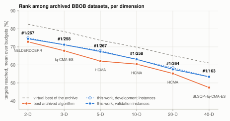
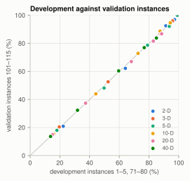
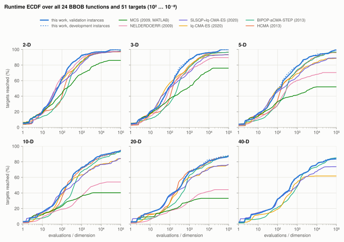
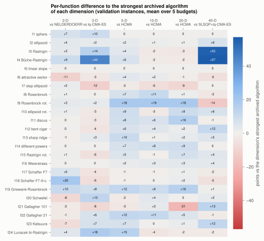

# dfo: a derivative-free optimization portfolio that leads the COCO/BBOB archive on mean score in 2 to 40 dimensions

**dfo** is a portfolio for bound-constrained black-box minimization, written
in Rust from the published algorithms. It combines:

- Multilevel Coordinate Search;
- a quasi-Newton phase;
- lq-CMA-ES with restarts that alternate large and small populations
  (BIPOP);
- L-SHADE;
- a *funnel race* for multi-funnel landscapes, which to our knowledge is
  new.

On the COCO/BBOB noiseless suite (24 functions, budgets 10·D to 10⁵·D
evaluations), its score is higher than that of every archived dataset
covering all 24 functions, in each of the six BBOB dimensions (163 to 267
datasets per dimension; Figure 1). The score is the fraction of targets
reached, averaged over five budgets (§2.1). The result holds on the 15
development instances used for tuning and on 15 separate validation
instances. The validation instances were not used for tuning, but they
vetoed four candidate changes (§2.1).

On the validation instances the portfolio leads the strongest archived
algorithm of each dimension by 1.7 to 6.0 percentage points. The 95%
bootstrap half-width of its own score is at most 0.8 points; the archived
algorithms' sampling error is not included. It is first in 19 of the 30
(dimension, budget) cells, and trails the archive's virtual best solver by
6.3 to 8.1 points.

**Contributions.**

1. An open, single-threaded Rust portfolio of these components. Its main
   dimension-dependent defaults are each justified by an ablation (§4).
2. The funnel race, which combines random-feature smoothing, monotonic
   basin hopping and successive halving. In 5-D it reaches all of the BBOB
   f24 (Lunacek bi-Rastrigin) targets at 10⁵·D, solving 15 of 15
   validation instances to 10⁻⁸. No archived algorithm exceeds 40%.
3. A comparison with the whole COCO archive under a per-budget eligibility
   rule, with a separate validation instance set and a record of the
   rejected ideas.
4. Surrogate kernels on Apple's AMX matrix unit and NEON that make
   full-quadratic lq-CMA-ES affordable in 40-D.



**Figure 1.** Score averaged over the budgets 10·D … 10⁵·D, per dimension.

- Solid blue: validation instances. Dotted blue: development instances.
- Labels: rank of the validation mean among the archived datasets covering
  all 24 functions.
- Orange: the strongest archived algorithm of each dimension, named below
  its point.
- Grey: the virtual best solver of the whole archive.

| | 2-D | 3-D | 5-D | 10-D | 20-D | 40-D |
|---|---|---|---|---|---|---|
| this work, validation instances | **74.5** | **71.2** | **67.4** | **63.1** | **57.5** | **53.4** |
| 95% bootstrap interval | 73.9–75.1 | 70.7–71.9 | 66.8–67.9 | 62.5–63.7 | 56.8–58.3 | 52.7–54.0 |
| best archived algorithm | 72.8 | 67.9 | 62.1 | 60.4 | 55.2 | 47.4 |
| | NELDERDOERR | lq-CMA-ES | HCMA | HCMA | HCMA | SLSQP+lq-CMA-ES |
| margin | +1.7 | +3.3 | +5.3 | +2.7 | +2.3 | +6.0 |
| virtual best of the archive | 82.6 | 78.5 | 73.7 | 69.8 | 65.2 | 61.0 |

## Contents

1. [Quick start](#1-quick-start)
2. [Results](#2-results)
3. [Method](#3-method)
4. [Ablations and negative results](#4-ablations-and-negative-results)
5. [Limitations](#5-limitations)
6. [Performance engineering](#6-performance-engineering)
7. [Implementation](#7-implementation)
8. [Reproducing the benchmark](#8-reproducing-the-benchmark)

## 1. Quick start

The crates are not on crates.io. Depend on them through git:

```toml
[dependencies]
dfo-portfolio = { git = "https://github.com/dessvp/dfo" }
```

```rust
let n = 10;
let (lo, hi) = (vec![-5.0; n], vec![5.0; n]);
let best = std::cell::Cell::new(f64::INFINITY);
let f = |x: &[f64]| {
    let v = x.iter().map(|t| (t - 1.234).powi(2)).sum::<f64>();
    best.set(best.get().min(v));
    v
};
let cfg = dfo_portfolio::HybridConfig::default();
let used = dfo_portfolio::minimize(f, || best.get() < 1e-10, &lo, &hi, f64::NEG_INFINITY, 100_000, &cfg);
```

(`cargo run --release --example quickstart`.)

- **Signature.** `minimize(f, done, lower, upper, ftarget, max_evals, &cfg)`
  returns the number of evaluations used, never more than `max_evals`.
- **Bounds.** `f` is only called inside the box: candidates outside it are
  projected onto it first, and the optimizers rank such a candidate by the
  projection's value plus a quadratic penalty on the distance (§3). The
  bounds must be finite with
  `lower[i] < upper[i]`; `minimize` panics otherwise, or if the dimension is
  0.
- **Failed evaluations.** A NaN value counts as +∞.
- **Best point.** `minimize` does not return the best point, so keep track
  of it inside `f`, as above.
- **Stopping.** `done` is polled between evaluations; here it stops at a
  target value. `ftarget` lets MCS stop early.
- **Configuration.** `HybridConfig` exposes the defaults described below,
  and the `dfo-bbob` driver maps its fields to command-line flags.

## 2. Results

### 2.1 Protocol

COCO/BBOB noiseless (Hansen et al. 2009, 2021), all 24 functions,
dimensions 2, 3, 5, 10, 20 and 40.

- **Score.** For a function and a budget of B·D evaluations,
  B ∈ {10, 100, 10³, 10⁴, 10⁵}, the score is the fraction of (run, target)
  pairs reached within B·D evaluations, over COCO's 51 targets
  f − f* ∈ {10², 10^1.8, …, 10⁻⁸}. A dimension's score at that budget is
  the mean over the 24 functions, in percent.
- **Mean over budgets.** The mean over the five budgets samples the runtime
  ECDF at five points evenly spaced in log budget. It is a five-point
  approximation of the area under that curve, computed from the runs as
  they are, without COCO's simulated restarts.
- **Instances.** Parameters were tuned only on instances 1–5 and 71–80
  (*development*). Instances 101–115 (*validation*) were run for each
  candidate release. In four cases (§4) a change that helped on the
  development instances was rejected because it lost on them. They are
  therefore a validation set, not an untouched test set.
- **Runs.** Each (function, instance) pair is run once, with a seed derived
  from the problem identifier, so results do not depend on how jobs are
  batched.
- **Archive.** We compare against every dataset in COCO's online archive
  that covers all 24 functions in the dimension: 267 datasets in all,
  downloaded on 24 October 2026 with cocopp 2.9.1. The archived datasets
  were run on their own instance sets and numbers of trials. As COCO
  intends, instances are treated as random draws of the same problem, so
  scores are compared across instance sets.
- **Per-budget ranks.** At budget B, an archived dataset counts only if
  every run it did not solve used at least B·D evaluations (Table 2). Without
  this rule, datasets that stopped early would count as failing at budgets
  they never ran.
- **Mean rank.** The rank on the mean is taken against all datasets
  covering the 24 functions. Datasets that stopped before 10⁵·D keep their
  last score at larger budgets, which lowers their mean. Restricted to the
  datasets that ran every budget, the portfolio is also first on the mean in
  every dimension.
- **Uncertainty.** The bootstrap intervals resample our 15 runs per function
  with replacement (1,000 resamples). They do not include the archived
  algorithms' own instance-to-instance variation, and no paired test
  against them was done.

### 2.2 Scores and ranks

**Table 1.** Score (%) and rank per budget. Per-budget ranks are among the
budget-eligible datasets of Table 2; the rank on the mean is among all
datasets covering the 24 functions. Bold: first.

| Dim | Row | 10·D | 100·D | 10³·D | 10⁴·D | 10⁵·D | Mean |
|---|---|---|---|---|---|---|---|
| 2-D | archive VBS | 31.0 | 84.8 | 97.5 | 99.6 | 100.0 | 82.6 |
| 2-D | development | 22.3 #2 | 64.1 #3 | 91.4 **#1** | 97.2 #11 | 100.0 **#1** | 75.0 **#1** |
| 2-D | validation | 20.9 #7 | 62.2 #4 | 92.5 **#1** | 97.0 #13 | 100.0 **#1** | 74.5 **#1** |
| 3-D | archive VBS | 25.7 | 74.9 | 93.4 | 98.3 | 100.0 | 78.5 |
| 3-D | development | 19.6 **#1** | 52.5 #5 | 87.5 **#1** | 95.9 #6 | 100.0 **#1** | 71.1 **#1** |
| 3-D | validation | 20.4 **#1** | 52.6 #5 | 87.1 **#1** | 96.0 #4 | 100.0 **#1** | 71.2 **#1** |
| 5-D | archive VBS | 23.2 | 64.1 | 86.7 | 96.4 | 97.8 | 73.7 |
| 5-D | development | 18.0 **#1** | 49.8 **#1** | 79.0 **#1** | 93.6 **#1** | 99.1 **#1** | 67.9 **#1** |
| 5-D | validation | 18.0 **#1** | 48.1 #2 | 78.7 **#1** | 92.2 **#1** | 100.0 **#1** | 67.4 **#1** |
| 10-D | archive VBS | 21.0 | 58.3 | 79.6 | 93.3 | 97.0 | 69.8 |
| 10-D | development | 15.9 **#1** | 44.2 **#1** | 72.6 **#1** | 87.4 **#1** | 94.3 #2 | 62.9 **#1** |
| 10-D | validation | 15.5 **#1** | 44.0 **#1** | 72.8 **#1** | 88.6 **#1** | 94.6 #2 | 63.1 **#1** |
| 20-D | archive VBS | 17.1 | 49.7 | 74.0 | 88.8 | 96.3 | 65.2 |
| 20-D | development | 15.0 **#1** | 37.3 **#1** | 68.1 **#1** | 82.9 **#1** | 88.5 **#1** | 58.4 **#1** |
| 20-D | validation | 14.9 **#1** | 37.4 **#1** | 67.0 #2 | 81.6 **#1** | 86.8 #3 | 57.5 **#1** |
| 40-D | archive VBS | 15.8 | 40.2 | 69.3 | 85.4 | 94.5 | 61.0 |
| 40-D | development | 13.7 #3 | 31.9 **#1** | 59.6 **#1** | 76.8 **#1** | 85.0 #2 | 53.4 **#1** |
| 40-D | validation | 13.6 #3 | 32.3 **#1** | 60.4 **#1** | 76.9 **#1** | 83.8 #2 | 53.4 **#1** |

"Archive VBS" is the virtual best solver: for every function, target and
budget, the best any archived algorithm reached. In 5-D at 10⁵·D the
portfolio (100.0) exceeds it (97.8), mostly because no archived algorithm
reaches as many f24 targets.

**Table 2.** Archived datasets ranked against, per budget (all cover the 24
functions).

| Dim | 10·D | 100·D | 10³·D | 10⁴·D | 10⁵·D |
|---|---|---|---|---|---|
| 2-D | 267 | 261 | 226 | 212 | 137 |
| 3-D | 258 | 253 | 220 | 206 | 106 |
| 5-D | 267 | 262 | 228 | 215 | 115 |
| 10-D | 258 | 253 | 223 | 208 | 108 |
| 20-D | 264 | 256 | 229 | 213 | 114 |
| 40-D | 163 | 162 | 155 | 142 | 72 |

On the validation instances the portfolio is first in 19 of the 30
(dimension, budget) cells, and in 22 on the development instances. Where it
is not first, the leader is a specialist for that budget:

- SLSQP-based methods at 10·D in 40-D;
- line-search and simplex methods (BrentSTEP, Nelder–Mead) and DTS-CMA-ES
  at 10·D–100·D in 2-D, and lq-CMA-ES at 100·D in 3-D and 5-D;
- SHADE variants at 10⁴·D in 2-D and 3-D, largely through f24;
- HCMA at 10³·D in 20-D, and HCMA and BIPOP-aCMA-STEP at 10⁵·D in 10-D to
  40-D.

Development and validation scores differ by at most 1.9 points in any cell
and by at most 0.9 points on the mean (Figure 2). The validation mean is
lower in three dimensions, higher in two and equal in 40-D, so there is no
consistent sign of overfitting to the development instances.



**Figure 2.** Each point is one (dimension, budget) cell: its score on the
development instances against the validation instances. The line is
y = x; the largest difference is 1.9 points.

Figure 3 shows where along the budget axis the lead arises, against six
reference algorithms:

- **2-D to 5-D.** The portfolio's curve is the highest of these from a few
  hundred ·D evaluations on.
- **10-D and 20-D.** It follows the upper envelope of the references:
  SLSQP+lq-CMA-ES up to about 10²·D, and HCMA beyond. It leads because no
  single reference does both.
- **40-D.** HCMA has no data, and BIPOP-aCMA-STEP passes the portfolio near
  10⁵·D.



**Figure 3.** Runtime ECDFs over all functions and targets. Solid blue:
validation instances; dotted blue: development instances. The comparison
set is:

- the strongest archived algorithm on the mean in each dimension
  (NELDERDOERR, lq-CMA-ES, HCMA, SLSQP+lq-CMA-ES);
- BIPOP-aCMA-STEP;
- the original MATLAB MCS (2009).

Algorithms without 40-D data are missing from that panel.

### 2.3 Per-function profile



**Figure 4.** Difference to the strongest archived algorithm of each
dimension, per function, as the mean over the five budgets (validation
instances).

Figure 4 shows that the gains are spread over the suite:

- the separable multimodal f3 and f4 in 2-D to 5-D and in 40-D;
- the sphere f1 in 2-D and 3-D (+7, +10);
- Rosenbrock and the high-conditioning unimodal functions (f8–f14) in 5-D
  to 20-D, except f10 in 10-D, and f12 in 40-D (+12);
- f18 in 2-D (+20) and f20 in 3-D (+13);
- f19 (Griewank–Rosenbrock) in 2-D to 20-D, and f22 (Gallagher 21) in 3-D
  to 20-D;
- f24 in 3-D and 5-D, and f21 (Gallagher 101) and f23 (Katsuura) in 40-D.

The losses of 5 points or more:

- f6, f20 and f23 in 2-D (against NELDERDOERR);
- f7, f15, f18 and f21 in 3-D (against lq-CMA-ES);
- f7 (step ellipsoid) in 10-D, and f7 and f21 in 20-D (against HCMA);
- f6, f9 and f18 in 40-D (against SLSQP+lq-CMA-ES).

There are none in 5-D.

### 2.4 Lunacek bi-Rastrigin (f24)

f24 (Lunacek et al. 2008) is among the hardest BBOB functions. Its two
funnels are covered by Rastrigin ripples, and the wider funnel, which CMA-ES
follows, is the wrong one. At 10⁵·D on the validation instances, the funnel
race (§3.5) solves f24 to 10⁻⁸ on 15 of 15 instances in each of 2-D, 3-D
and 5-D. In 5-D it reaches all of the targets. The best
archived algorithms on f24 in 5-D, PSO-BFGS and NBIPOP-aCMA-ES, reach 40% at
10⁵·D.

## 3. Method

`minimize` runs phases 1–4 once, in order. Phase 5 shares the remaining
evaluations between the restart regimes defined in §3.4. Every candidate
is projected onto the box before it is evaluated, since CMA-ES and L-SHADE
sample unbounded distributions. A candidate `x` with projection `xc` is
ranked by `f(xc) + 1e4·Σᵢ((xᵢ − xcᵢ)/(vᵢ − uᵢ))²`. On BBOB's box [−5, 5]ⁿ
this is `100·Σᵢ(xᵢ − xcᵢ)²`, the suite's own boundary penalty. Without the
penalty, the projection leaves a flat plateau outside the box, where
large-population CMA-ES restarts drift. In a full run with projection alone,
f15 in 20-D reached 14% of its targets at 10⁵·D (development instances),
against 100% with the penalty.

| Phase | Component | Dimensions | Budget |
|---|---|---|---|
| 1 | Multilevel Coordinate Search | all (from 20-D only its initialization) | 10n (2.1n from 20-D) |
| 2 | separability test, then a coordinate-wise pass on separable functions | test in all; pass up to 5-D | at most 6 evaluations; as needed |
| 3 | bound-constrained BFGS | from 5-D | 30n (5–9-D), 100n (from 10-D) |
| 4 | first lq-CMA-ES run: from the BFGS state from 5-D, from MCS's best point in 3–4-D, from the box centre in 2-D | all | until it stops |
| 5 | restart regimes L, S, M, D, F | see §3.4 | the rest |

### 3.1 Multilevel Coordinate Search

MCS (Huyer & Neumaier 1999) partitions the box into a tree of boxes, split
one coordinate at a time, and balances global and local search by sweeping
the tree level by level. Our implementation follows the paper: the
initialization list, the splitting rules by level and rank, the record list
and the shopping basket of local-search starts. It departs from the paper
in four places:

- **Local search.** The paper's local search (triple searches, a quadratic
  model, a line search) is replaced by BOBYQA (Powell 2009), a trust-region
  method on the same kind of quadratic models. It runs in two stages, a
  coarse one and then a fine one with a smaller trust-region radius.
- **Basket screening.** Candidates in the shopping basket are screened with
  a single-linkage critical distance (Rinnooy Kan & Timmer 1987).
- **Depth limit.** The depth limit `smax` is raised when every box has
  reached it, instead of stopping.
- **Local-search radius.** In the portfolio, the radius is at least 2% of
  the narrowest box width.

The search is resumable: `Mcs::run` performs whole steps up to an
evaluation quota and continues from the same state on the next call, so the
portfolio can interleave MCS with other regimes on one thread. MCS's
evaluations also serve as the initial surrogate data of CMA-ES.

### 3.2 Separability and the coordinate-wise solver

At MCS's best point, the mixed second difference
f(x + a·eᵢ + b·eⱼ) − f(x + a·eᵢ) − f(x + b·eⱼ) + f(x) is evaluated on two
random coordinate pairs; it vanishes for additively separable functions.

Separable problems up to 5-D are then solved coordinate by coordinate,
before anything else:

1. A pass of bracketing and Brent's method (Brent 1973) on each coordinate,
   at most 30 evaluations each.
2. An 81-point grid over each coordinate's range.
3. Short Brent searches in the best grid minima, which rank neighbouring
   basins of oscillating coordinates.
4. A full-accuracy Brent search in the best basin.

In any dimension, a separable function that the first CMA-ES run does not
solve gets steps 2–4 with a 201-point grid, from the best point so far. The
solver lifts 100·D by 1.6 points in 2-D and 0.5 in 3-D (§4), and gives the
large gains on f3 and f4 (Figure 4).

### 3.3 Quasi-Newton phase and handover

Quasi-Newton methods with finite differences are the strongest archived
methods at small budgets: SLSQP-11-scipy and SLSQP+lq-CMA-ES lead at 10·D
and 100·D in 10-D to 40-D. Two choices decide the phase's speed:

- **A large initial inverse Hessian, not rescaled.** H₀ = (0.1·w)²·I, where
  w is the narrowest box width; above 20-D it is one tenth of that (§4).
  BFGS corrects eigenvalues that are too large within a few backtracked
  steps, but corrects those that are too small only slowly (Nocedal 1992).
  The usual Shanno–Phua rescaling (Shanno & Phua 1978; Nocedal & Wright
  2006, eq. 6.20) makes every flat direction of an ill-conditioned function
  too small. On a condition-10⁶ ellipsoid in 20-D it needed 182·D
  evaluations to reach f = 1 instead of 34·D, and on BBOB it costs 5–11
  points at 100·D (§4).
- **Forward differences, then central differences.** Forward differences
  carry a bias that stalls rotated problems near f − f* ≈ 10⁻⁶. Once they
  stop making progress, the search switches to central differences.

Bounds are handled in the reduced space of the free coordinates, with an
extension step along the projected path.

The first CMA-ES run inherits the BFGS inverse Hessian as its covariance and
the recent step lengths as its step size. Schröder et al. (2022) found that
a switch from BFGS to CMA-ES gains only when CMA-ES's parameters are
warm-started. On non-smooth functions that inverse Hessian is wrong (BBOB
f6), so after 200n evaluations the run clips its covariance's condition
number to 10², once. In 20-D the clip lifts the 1000·D score on f6–f14 from
89.2 to 96.1.

### 3.4 lq-CMA-ES and the restart regimes

All CMA-ES runs use the default parameters of Hansen's tutorial (2016) with
the active covariance update. Except for the funnel race's local searches,
they are assisted by the linear-quadratic global surrogate of lq-CMA-ES
(Hansen 2019). Ranking and whitening follow the defaults of its reference
implementation in pycma (Hansen et al. 2019):

- **Ranking.** Each generation, a least-squares model fitted to recent
  points ranks the candidates. Candidates are evaluated in model order until
  the model ranks the true values well (Kendall τ-b ≥ 0.85).
- **Whitened coordinates.** The model is fitted in the whitened coordinates
  of the search distribution, which keeps the least-squares problem well
  conditioned.
- **Model kind.** The model is the richest the data support (linear,
  diagonal quadratic, full quadratic).

Two additions are ours:

- **Diagonal restarts above 20-D.** Full quadratics are allowed in the
  first run in every dimension, but in restarts only up to 20-D.
- **Gating.** From 15-D, a gate pauses the model when an exponential moving
  average (factor 0.9) of the fraction of each population that had to be
  evaluated exceeds 0.85. The pause lasts 4 generations and doubles on each
  repetition, up to 256; the archive keeps being fed in the meantime.

After the first run, each restart goes to the regime that has used the
fewest evaluations per unit of weight. This generalizes BIPOP's balancing
between large and small populations (Hansen 2009).

| Regime | Description | Dimensions | Weight |
|---|---|---|---|
| L | lq-CMA-ES, population doubling per restart (IPOP; Auger & Hansen 2005) | all | 2 up to 4-D; 1 in 5–19-D; 2 from 20-D (1 in 20-D after 10⁴n) |
| S | lq-CMA-ES, small random populations and step sizes (BIPOP) | all | 1 |
| M | the initial MCS, resumed | ≤ 4-D | 1 |
| D | L-SHADE (Tanabe & Fukunaga 2014) | 6–20-D, after 10⁴n | 1 |
| F | funnel race (§3.5) | ≤ 5-D, after 10⁴n | 3 |

Weights are relative; a regime outside its dimensions is off. D and F
become eligible only once the total evaluations reach 10⁴n.

**Budget accounting.**

- The initial MCS evaluations count towards regime M.
- The BFGS, coordinate-wise and first-run evaluations count towards L.
- Each S run is capped at L's total so far, as in BIPOP.
- D and F start from zero once they become eligible, so F's weight of 3
  then gives it most of the remaining budget in up to 5-D. Their first runs
  get 10³n and 6·10⁴n evaluations, doubling on each later run.

The resumed MCS keeps refining its partition and finds isolated basins that
the CMA-ES regimes miss. L-SHADE runs with the published parameters
(N_init = 18n, N_min = 4, H = 6, archive rate 2.6, p = 0.11). As in SHADE
(Tanabe & Fukunaga 2013), the p-best set has at least two members, and as
in JADE (Zhang & Sanderson 2009), a component that leaves the box is set
halfway between the parent and the bound. NBIPOP's
adaptive budget split and best-regime boost (Loshchilov 2013) are
implemented but off by default.

### 3.5 The funnel race

On landscapes like f24, a smooth big-valley structure hides behind ripples.
CMA-ES with large populations follows the widest funnel, and local searches
cannot tell funnels apart. The funnel race works in three steps:

1. **Map.** A one-shot ridge regression on random Fourier features (Rahimi &
   Recht 2007) of low bandwidth, fitted to uniform samples, smooths out the
   ripples. Its distinct minima are candidate funnels. The map locates
   funnels but cannot rank them, because the wider, wrong funnel has the
   lower smoothed mean.
2. **Race.** Each candidate gets a monotonic basin-hopping chain (Leary
   2000; Grosso et al. 2007): a perturbation of about one ripple, a
   small-population CMA-ES local search, and acceptance only on
   improvement. Successive halving (Karnin et al. 2013) keeps the better
   half of the chains with twice the budget, until one is left.
3. **Envelope steps.** Every few hops, a chain fits a full quadratic to its
   best local minima, which lie on the funnel's smooth envelope, and
   searches at its minimizer. Random hops rarely land in the right
   Rastrigin cell (the basin of one ripple) near a flat funnel bottom.

With weight 3 from 10⁴n evaluations, the race lifts the 10⁵·D score from
98.1 to 99.7 in 2-D, from 97.3 to 99.9 in 3-D and from 96.6 to 99.7 in 5-D
(development instances). It does not run before 10⁴n evaluations, so
smaller budgets are unaffected. In 10-D it brought no gain.

## 4. Ablations and negative results

Every default was accepted on the development instances, one change at a
time; candidate releases were then checked on the validation instances.
The deltas below are development-instance scores from a single run per
instance (three seeds where noted), measured when each change was made.
They build on one another and do not add up to the final result. They
predate the boundary penalty of §3, which moved final scores by up to 3
points in a cell, so their end values can differ from Table 1.

| Component | Setting | Effect (development instances) |
|---|---|---|
| BFGS phase, large H₀ | 100n, from 10-D | 20-D mean over 10·D–10⁴·D 51.0 → 53.2 (100·D 23.2 → 34.7); 10-D 59.0 → 59.5 (three seeds) |
| short BFGS phase in 5-D | 30n | mean 67.1 → 67.7, 100·D 49.4 → 50.3; in 3-D it loses (100·D 55.4 → 53.7) |
| condition clip after the warm start | 10² after 200n | 20-D 1000·D on f6–f14 89.2 → 96.1 (f6 42 → 100) |
| MCS initialization only, from 20-D | 2.1n | 20-D 10·D 14.0 → 14.9, 100·D 34.7 → 36.7; 40-D 13.6 → 14.7, 25.7 → 28.7; in 10-D it loses |
| L:S weights 2:1, from 20-D | | 20-D 1000·D 66.5 → 67.6 (f7 36 → 63) |
| smaller BFGS H₀ in 40-D | ×0.1 | 100·D 29.6 → 31.8, 1000·D 60.3 → 61.1; 10·D 14.5 → 13.7 |
| first CMA-ES run from the box centre, 2-D | | 100·D 62.0 → 65.1, 1000·D 90.4 → 91.3, 10⁴·D 97.1 → 96.9; in 3-D it loses (1000·D 87.5 → 85.5) |
| resumed MCS (regime M) | ≤ 4-D | f15–f24: +3.6 (2-D), +1.6 (3-D); −0.9 (5-D), −1.8 (10-D) |
| coordinate-wise solver on separable functions | ≤ 5-D | 100·D +1.6 (2-D), +0.5 (3-D) |
| funnel race | weight 3, ≤ 5-D | 10⁵·D 98.1 → 99.7 (2-D), 97.3 → 99.9 (3-D), 96.6 → 99.7 (5-D) |
| L-SHADE | 6–20-D, from 10⁴n | 10-D 10⁵·D 92.9 → 94.7; 20-D 10⁵·D on f15–f24 67.0 → 71.0 |

Ideas that were tested and rejected, recorded so that they are not retried:

- **Vetoed on the validation instances.** Four changes gained on the
  development instances and lost on the validation instances, by −0.5 to
  −1.4:
  - NIPOP step-size decay;
  - NBIPOP's best-regime boost;
  - tabu restarts;
  - L:S weights 2:1 in 10-D (+0.4 on development, −1.3 on validation).
- **Shanno–Phua scaling of the BFGS H₀:** 100·D falls by 5–11 points in
  5–40-D (f2, f10, f11).
- **Plain CMA-ES (no surrogate) for large-population restarts:** noise in
  40-D, clear losses in 10-D and 20-D.
- **More budget for small populations in 20-D:** f21 +22 to +33, but f7,
  f15, f16 and f18 lose as much. The split between L and S is zero-sum
  there.
- **Quasi-Newton restarts from random points:** f21 +25, f7 −25 in 20-D.
- **An earlier funnel race, L-SHADE, or a grid multistart with BFGS in
  2-D:** f24 at 10⁴·D rose at most from 32 to 49. The stretched ripples of
  f24 alias any affordable grid.
- **Wider restart step sizes in 40-D:** +18 on f16 over four instances, −15
  over six others.

## 5. Limitations

- **The virtual best solver stays ahead,** by 6.3 to 8.1 points on the
  mean. No single algorithm, this one included, dominates the archive.
- **Cells where specialists lead.** The non-first cells are listed in §2.2.
  The largest gaps come down to one or two functions:
  - f24 at 10⁴·D in 2-D and 3-D, where SHADE-LM reaches 90% of the targets
    in 2-D against our 29%;
  - f21 in 20-D and f16 and f23 in 40-D at 10⁵·D, against HCMA and
    BIPOP-aCMA-STEP. On the mean over budgets, f21 and f23 in 40-D are
    gains (Figure 4).

  Retuning the budget split did not close them (§4).
- **Instances are not new problems.** BBOB instances differ only by shifts,
  rotations and offsets of the same 24 functions. The validation set
  measures robustness to these transformations, not generalization to other
  problems.
- **Uncertainty of the ranks.** The intervals cover only our runs. The
  smallest margin (2-D, +1.9) is about three times our half-width.
- **Single-run ablations.** Deltas of about 0.5 points or less, such as the
  four vetoes or 10-D 59.0 → 59.5, are within run-to-run noise.
- **Metric.** Scores omit COCO's simulated restarts and compare across
  instance sets and trial counts. They are not COCO's standard bootstrapped
  ECDF.
- **Tuned for BBOB.** Other problem classes may want other weights.
- **Dimension thresholds.** The default switches sit at BBOB's dimensions.
  Behaviour between them (4, 6–9, 11–19 and 21–39-D) and above 40-D is
  untested.
- **Overhead.** In 40-D the surrogate costs about 1 ms per evaluation. For
  cheap objectives, wall-clock time rather than evaluations is the limit.
- **Bound constraints only.**
- **Benchmarked on macOS only.** The test suite passes on Linux (aarch64
  and x86-64) with the portable kernels, but the benchmark ran only on
  macOS/aarch64.

## 6. Performance engineering

The benchmark runs 4,320 optimizations (24 functions × 30 instances × 6
dimensions) of up to 4·10⁶ evaluations each. The cost is dominated by the
surrogate fit in 20-D and 40-D. A full quadratic model in 40-D has 861
coefficients, fitted on about 1,300 points after every batch of
evaluations.

**Dense kernels.** The normal equations AAᵀ are formed with Accelerate's
`dsyrk` on Apple's AMX matrix unit and solved with Accelerate's `dpotrf`.
Below 48 coefficients the portable kernels are faster than the call
overhead: register-tiled NEON code with eight accumulators on aarch64,
scalar loops elsewhere. On platforms other than macOS the portable kernels
are used throughout.

**Table 3.** Surrogate-fit kernels, M1 Max, one core
(`cargo run --release --example kernels`).

| Model | p × m | Gram AAᵀ, portable → AMX | Cholesky solve, portable → AMX |
|---|---|---|---|
| 10-D, full | 66 × 100 | 13.2 → 6.9 µs (1.9×) | 21.0 → 7.7 µs (2.7×) |
| 20-D, full | 231 × 347 | 487 → 103 µs (4.7×) | 459 → 79 µs (5.8×) |
| 40-D, full | 861 × 1292 | 23.9 → 3.4 ms (6.9×) | 22.9 → 1.7 ms (13.4×) |

Three further choices mattered. Their timings were measured during
development, under the load of a running benchmark, so they differ from
Table 3:

- **Feature-major layout.** Storing A as p × m makes `dsyrk` run
  untransposed: 6 ms instead of 14 ms in 40-D.
- **One BLAS thread.** Accelerate is pinned to the calling thread with
  `BLASSetThreading`. The benchmark already runs one process per core, and a
  single thread is also faster per call. Setting `VECLIB_MAXIMUM_THREADS`
  from inside the process comes too late.
- **New LAPACK interface.** The `$NEWLAPACK` `dpotrf` took 2.0 ms against
  3.0 ms for the legacy symbol.

Together these brought the cost of one 40-D lq-CMA-ES evaluation from
3.3 ms to about 1 ms. Single-precision AMX with double-precision refinement
was tried and rejected: the Gram matrix often has a condition number above
10⁷, where the refinement fails.

**Elsewhere.**

- The CMA-ES eigendecomposition uses LAPACK's divide-and-conquer `dsyevd`
  (cyclic Jacobi off macOS).
- MCS keeps points and boxes in flat arrays and its record list in one
  min-heap per level with lazy invalidation, so a split copies contiguous
  memory and allocates nothing in steady state.
- The surrogate's workspace is reused across fits. A fitted full quadratic
  model is invariant to affine changes of coordinates, so it is reused until
  new points arrive.

**Table 4.** lq-CMA-ES alone, evaluations to f − f* < 10⁻⁸ on rotated
functions in [−5, 5]ⁿ, median of 5 seeds
(`cargo run --release --example lq_bench -- {sphere|elli|rosen} N`).

| Function | 10-D | 20-D | 40-D |
|---|---|---|---|
| sphere | 32 | 62 | 121 |
| ellipsoid, condition 10⁶ | 100 | 342 | 1,271 |
| Rosenbrock | 1,381 | 5,416 | 23,396 |

The 10-D ellipsoid takes 100 evaluations, the same as pycma. Before the
audit described in §7 it took 306.

## 7. Implementation

| Crate | Contents | Lines |
|---|---|---|
| `dfo-mcs` | Multilevel Coordinate Search with BOBYQA local search, resumable | 1,151 |
| `dfo-cmaes` | CMA-ES (active update, IPOP), the lq surrogate, AMX/NEON kernels | 1,582 |
| `dfo-portfolio` | `minimize`, BFGS, L-SHADE, funnel race, coordinate-wise solver | 2,033 |
| `dfo-bbob` | COCO/BBOB driver (vendored COCO 2.8.2, BSD-3-Clause) | 348 |

`bench/` holds the benchmark and analysis scripts (§8).

- **Independent implementation.** Each component is written from its
  publication. The surrogate's model-building rules follow pycma
  (BSD-3-Clause), reimplemented rather than translated. The repository
  contains no code from the MATLAB MCS or from any other optimizer, apart
  from the vendored COCO, whose C sources include an adaptation of SciPy's
  `brentq`.
- **Dependencies.** The only external crate is `bobyqa` (MIT OR
  Apache-2.0), a port of BOBYQA from PRIMA (BSD-3-Clause). On macOS the
  kernels also use Apple's Accelerate framework. `THIRD-PARTY-NOTICES`
  reproduces the licences of COCO, PRIMA and pycma.
- **Single thread.** `minimize` runs on the caller's thread with no threads
  of its own; MCS is paused and resumed rather than run concurrently.
- **Tests** (`cargo test --release`, 26 tests; CI runs them with `rustfmt`
  and `clippy -D warnings` on macOS and Linux, and builds with Rust 1.88)
  cover:
  - `minimize` end to end: easy problems solved from 1-D to 10-D; the
    budget never exceeded and the reported count exact, for budgets from 0
    to 5000 in 1-D to 20-D; every evaluation inside the box, including
    narrow, asymmetric bounds and an optimum on the boundary; NaN and +∞
    values; constant functions; determinism per seed; stopping on `done`;
    rejection of invalid bounds;
  - MCS on the nine Jones et al. (1993) test problems, to the paper's
    Table II criterion, and equality of resumed and uninterrupted MCS runs;
  - the AMX kernels against the portable ones and against naive references,
    the eigendecomposition and the Cholesky solve;
  - BFGS on a rotated ellipsoid, its reduced-space direction and its bound
    handling;
  - CMA-ES on a reference sphere run, lq-CMA-ES on an ellipsoid, and
    Kendall τ-b with ties;
  - L-SHADE on 2-D Rastrigin.

  The funnel race is covered only by the benchmark.
- **Release audit.** Before publication, the code was audited for
  provenance against the MATLAB MCS and pycma, and for robustness. The
  robustness audit made `minimize` project every candidate onto the box
  with a distance penalty (CMA-ES had evaluated points outside it), treat
  NaN as +∞ and validate its
  inputs, and made the public BLAS wrappers check their slice lengths. The
  results in §2 were rerun with these changes.
- **Audit.** Before tuning, every component was audited for correctness and
  speed. The audit fixed:
  - a biased ridge term in the surrogate (the 3× slowdown above);
  - a model gate that could switch the surrogate off permanently;
  - bound handling in BFGS;
  - quota handling in the MCS interleaving;
  - a seed that depended on job batching.

## 8. Reproducing the benchmark

**Requirements.**

- Rust 1.88 or later.
- A C compiler for the vendored COCO; on macOS, the Xcode command-line
  tools, which also provide Accelerate.
- Python 3 with the pinned packages of `bench/requirements.txt`.

**Run.**

```bash
cargo build --release
bash bench/final.sh final 8
```

`final.sh` runs 720 jobs, one per function and instance chunk on the
development and validation instances, 8 at a time. Results go to
`bench/exdata/final/{P,U}{dim}`.

- `DIMS` and `SETS` restrict the run, `BIN` selects another driver binary,
  and `EXTRA` passes extra driver flags.
- The script refuses to write into an existing output folder, because COCO
  would add a second copy of the runs.
- At the end it lists any job whose folder is missing.

For scale, 40, 20, 5 and 2-D on both instance sets took under 2.5 hours on
a 10-core M1 Max.

**Analyse.** From `bench/`:

```bash
python3 -m venv .venv && .venv/bin/pip install -r requirements.txt
.venv/bin/python archive_all.py
.venv/bin/python archive_budgets.py
.venv/bin/python readme_rows.py final
.venv/bin/python stats.py final
.venv/bin/python figures.py final
```

1. `archive_all.py` downloads every archived dataset and caches its scores,
   one dataset at a time.
2. `archive_budgets.py` caches how long each dataset's runs ran, for the
   budget rule. Both scripts run once. A dataset that fails to download is
   reported on stderr and left out, so rerun them until none fail.
3. `readme_rows.py` prints Table 1, through `rank_all.py`, which also ranks
   any result folder and lists the leaders per budget
   (`rank_all.py NAME=FOLDER … --eligible --top 3`).
4. `stats.py` prints the bootstrap intervals, the rank among the datasets
   that ran every budget, and the f24 results.
5. `figures.py` draws Figures 1–4 into `docs/figures`.

The ablation deltas of §4 were measured with the driver's flags (one per
`HybridConfig` field) and are not scripted.

**Bit-reproducibility.** Results are bit-reproducible on macOS/aarch64. On
other platforms the portable kernels change the floating-point
trajectories, so scores will be statistically similar but not identical.

## References

Archived algorithms are named as in the COCO data archive
(https://coco-platform.org/testsuites/bbob/data-archive.html), which links
each dataset to its paper.

- A. Auger, N. Hansen. A restart CMA evolution strategy with increasing population size. *IEEE CEC* (2005) vol. 2, 1769–1776.
- R. P. Brent. *Algorithms for Minimization without Derivatives*. Prentice-Hall (1973).
- A. Grosso, M. Locatelli, F. Schoen. A population-based approach for hard global optimization problems based on dissimilarity measures. *Math. Program.* 110 (2007) 373–404.
- N. Hansen. Benchmarking a BI-population CMA-ES on the BBOB-2009 function testbed. *GECCO Companion* (2009) 2389–2396.
- N. Hansen. The CMA Evolution Strategy: A Tutorial. arXiv:1604.00772 (2016).
- N. Hansen. A global surrogate assisted CMA-ES. *GECCO* (2019) 664–672.
- N. Hansen, Y. Akimoto, P. Baudis. CMA-ES/pycma. Zenodo, doi:10.5281/zenodo.2559634 (2019).
- N. Hansen, S. Finck, R. Ros, A. Auger. Real-parameter black-box optimization benchmarking 2009: noiseless functions definitions. INRIA research report RR-6829 (2009).
- N. Hansen, A. Auger, R. Ros, O. Mersmann, T. Tušar, D. Brockhoff. COCO: a platform for comparing continuous optimizers in a black-box setting. *Optim. Methods Softw.* 36 (2021) 114–144.
- W. Huyer, A. Neumaier. Global optimization by multilevel coordinate search. *J. Global Optim.* 14 (1999) 331–355.
- D. R. Jones, C. D. Perttunen, B. E. Stuckman. Lipschitzian optimization without the Lipschitz constant. *J. Optim. Theory Appl.* 79 (1993) 157–181.
- Z. Karnin, T. Koren, O. Somekh. Almost optimal exploration in multi-armed bandits. *ICML* (2013).
- R. H. Leary. Global optimization on funneling landscapes. *J. Global Optim.* 18 (2000) 367–383.
- I. Loshchilov. CMA-ES with restarts for solving CEC 2013 benchmark problems. *IEEE CEC* (2013) 369–376.
- M. Lunacek, D. Whitley, A. Sutton. The impact of global structure on search. *PPSN X* (2008).
- J. Nocedal. Theory of algorithms for unconstrained optimization. *Acta Numerica* 1 (1992) 199–242.
- J. Nocedal, S. J. Wright. *Numerical Optimization*, 2nd ed. Springer (2006).
- M. J. D. Powell. The BOBYQA algorithm for bound constrained optimization without derivatives. Tech. rep. DAMTP 2009/NA06, University of Cambridge (2009).
- A. Rahimi, B. Recht. Random features for large-scale kernel machines. *Advances in NIPS* 20 (2007) 1177–1184.
- A. H. G. Rinnooy Kan, G. T. Timmer. Stochastic global optimization methods, part I: clustering methods. *Math. Program.* 39 (1987) 27–56.
- D. Schröder, D. Vermetten, H. Wang, C. Doerr, T. Bäck. Switching between numerical black-box optimization algorithms with warm-starting policies. arXiv:2204.06539 (2022).
- D. F. Shanno, K. H. Phua. Matrix conditioning and nonlinear optimization. *Math. Program.* 14 (1978) 149–160.
- R. Tanabe, A. Fukunaga. Success-history based parameter adaptation for differential evolution. *IEEE CEC* (2013) 71–78.
- R. Tanabe, A. Fukunaga. Improving the search performance of SHADE using linear population size reduction. *IEEE CEC* (2014) 1658–1665.
- J. Zhang, A. C. Sanderson. JADE: adaptive differential evolution with optional external archive. *IEEE Trans. Evol. Comput.* 13 (2009) 945–958.

## Citing

If you use dfo in research, please cite it. GitHub's "Cite this
repository" button gives the same entry from [CITATION.cff](CITATION.cff).

```bibtex
@software{petrov2026dfo,
  author  = {Petrov, Desislav},
  title   = {dfo: a derivative-free optimization portfolio for
             bound-constrained black-box minimization},
  year    = {2026},
  version = {0.1.0},
  url     = {https://github.com/dessvp/dfo}
}
```

## License

Licensed under either of [Apache License, Version 2.0](LICENSE-APACHE) or
[MIT license](LICENSE-MIT), at your option. The vendored COCO sources in
`crates/bbob/coco` are BSD-3-Clause; see
[THIRD-PARTY-NOTICES](THIRD-PARTY-NOTICES) for them and for PRIMA and
pycma.
